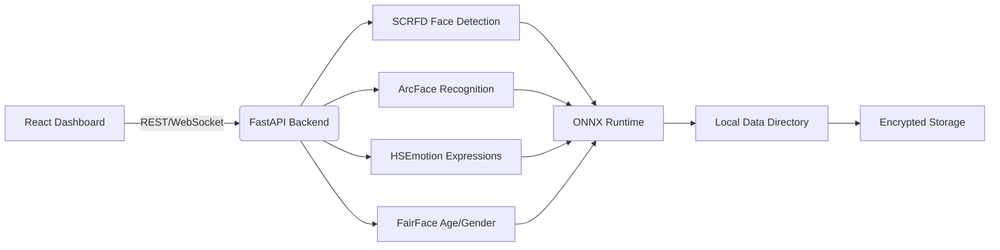

# 🚀 Face Intelligence System

> 🔒 **Privacy-first** face analysis for local development with consent-based biometric processing

[](https://www.python.org/)
[](https://fastapi.tiangolo.com/)
[](https://react.dev/)
[](https://www.typescriptlang.org/)
[](https://onnxruntime.ai/)
[](LICENSE)

> A local-first computer-vision workspace for detection, recognition,
> expression analysis, and approximate age estimation.

## 🌟 Why this project stands out

- 🔐 **Privacy by design**: biometric data stays in the configured local data directory
- ⚡ **Live analysis**: webcam streaming over an authenticated WebSocket
- 🤝 **Consent-first enrollment**: explicit consent is required before storage
- 🧠 **Model-driven pipeline**: OpenCV and ONNX Runtime power the analysis flow
- 🛡️ **Defense in depth**: RBAC, origin checks, rate limits, validation, and integrity checks

## ✨ Key Capabilities

- 👁️ **Advanced Detection**: 5-point facial landmark tracking with SCRFD model
- 🎭 **Expression Analysis**: HSEmotion ENet-B0 expression classification
- 🧑‍🤝‍🧑 **Approximate Estimation**: Age and gender analysis with a FairFace ensemble
- 🔍 **ArcFace Recognition**: High-accuracy face matching with ONNX Runtime
- 🔒 **Secure Storage**: Encrypted biometric embeddings with key management
- 📡 **Live Streaming**: Real-time webcam analysis via authenticated WebSocket

## 🏗️ Modern Architecture



## 🧭 Quick navigation

- [Architecture](#-modern-architecture)
- [Quick start](#-quick-start-modernized)
- [Authentication](#-authentication-system)
- [Testing](#-testing--validation)
- [Security and privacy](#️-security--privacy-features)
- [Responsible use](#responsible-use)

## 📂 Repository structure

```
face-intelligence/
├── 🖥️ frontend/ (React + Vite)
├── ⚙️ backend/ (FastAPI + ONNX)
├── 🧪 models/ (Model assets and trusted manifest)
├── 📁 data/ (Local biometric storage)
└── 📚 docs/ (Privacy & model documentation)
```

## 🚀 Quick start

### 1. Set Up Environment

```powershell
# Create isolated environment
python -m venv backend\.venv
backend\.venv\Scripts\Activate.ps1

# Install dependencies
pip install --upgrade pip
pip install -r backend\requirements.txt
```

### 2. Provision and verify model assets

```powershell
pip install -r backend\requirements-models.txt
python backend\scripts\download_models.py
$env:PYTHONPATH = "backend"
python -m app.security.model_integrity verify
```

Model weights are intentionally not committed to Git. The provisioning script
checks archive members, ONNX Runtime loadability, file sizes, and SHA-256
hashes from `models/model_manifest.json`.

### 3. Configure Security

```powershell
# Generate encryption keys (run once)
python -c "import base64,secrets;
print('FACE_ENCRYPTION_KEY=' + base64.b64encode(secrets.token_bytes(32)).decode());
print('FACE_ENCRYPTION_SALT=' + base64.b64encode(secrets.token_bytes(32)).decode())"
```

> 🔐 **Never commit keys** - store in secure environment variables

### 4. Launch Services

```powershell
# Start backend server
$env:PYTHONPATH = "backend"
python -m uvicorn app.main:app --reload --port 8000

# Start frontend dev server (in separate terminal)
cd frontend
npm install
npm run dev
```

🌐 **Access Points**:
- Dashboard: <http://127.0.0.1:5173>
- API Docs: <http://127.0.0.1:8000/docs>
- Health Check: <http://127.0.0.1:8000/health>

## 🔐 Authentication System

| Method | Usage |
|--------|-------|
| 🔑 `X-API-Key` header | REST API authentication |
| 🔑 `Authorization: Bearer <key>` | REST API authentication |
| 🔑 `token=fi_...` query | WebSocket authentication |
| 🧑‍💼 **Roles** | `ADMIN` (full access) > `OPERATOR` > `VIEWER` > `SERVICE` |

## 🧪 Testing and validation

```powershell
# Run all backend tests
$env:PYTHONPATH = "."
backend\.venv\Scripts\python.exe -m pytest backend\tests -q

# Build production frontend
cd frontend
npm run build
```

✅ **Latest validation**:
- 177/177 backend tests passed
- 6 backend tests skipped because they require a consented real-face dataset
- 1 existing Starlette/httpx deprecation warning
- Frontend TypeScript and Vite production build passed
- Required model integrity verification passed

## 🛡️ Security & Privacy Features

- 🔒 **AES-256-GCM encryption** for stored biometric embeddings
- 🚫 **No analytics or telemetry** in the application
- 👥 **Consent workflow** required for enrollment
- 📏 **Input validation** for all file uploads
- 🌐 **Origin verification** for WebSocket connections
- 🕒 **Rate limiting** on all endpoints
- 🧯 **Fail-closed production behavior** for unsafe configuration and storage

📖 **Full privacy policy**: [docs/PRIVACY.md](docs/PRIVACY.md)

## 📖 License & Acknowledgments

- 📄 **License**: MIT License [LICENSE](LICENSE)
- 🙏 **Thanks to**: InsightFace, HSEmotion, FairFace, ONNX Runtime, OpenCV

## Responsible use

This project is for research, development, and controlled demonstrations.
Face recognition and demographic estimation can affect people in serious ways.
Use informed consent, clear notice, strict access control, and a lawful purpose.
Never use these outputs for legal decisions, age-gating, access control,
employment decisions, or any other consequential decision about a person.